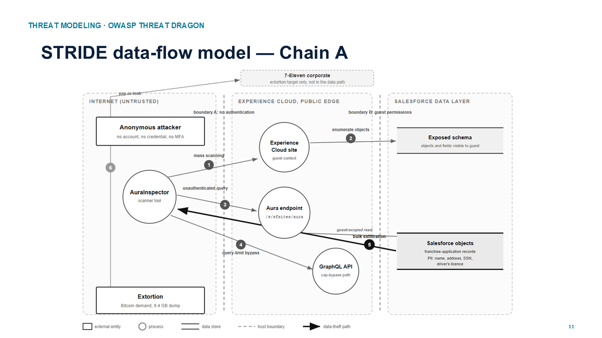
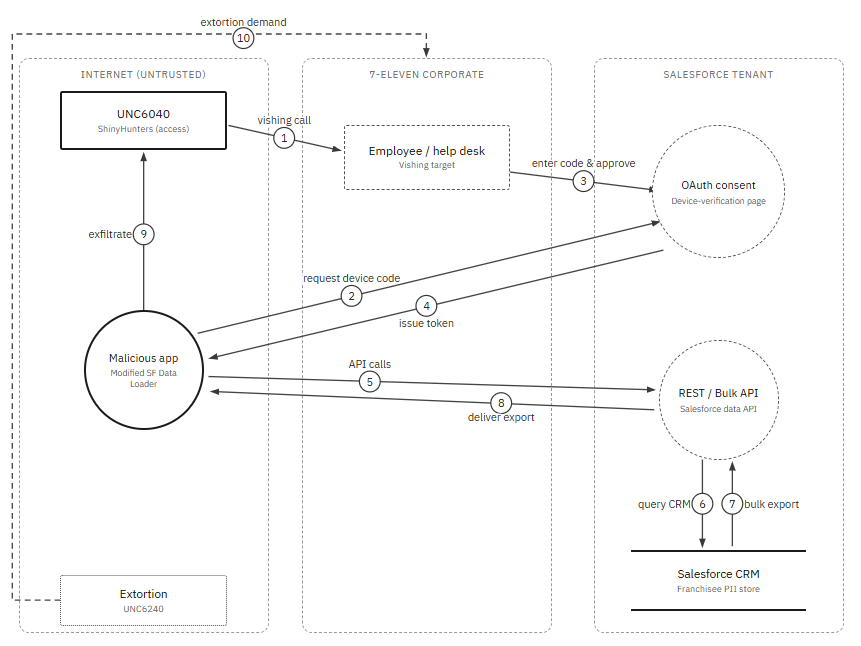

# 7-Eleven Franchisee Breach: Threat Model and Risk Assessment

**When trust is the vulnerability.** An analysis of the 2026 7-Eleven franchisee data breach, tied to the ShinyHunters Salesforce data-theft campaign. It covers threat modelling, root cause, severity, mitigation and detection.

Course project for *Advanced Topics in Cyber Security*, Honours Bachelor of Information Sciences (Cyber Security), Sheridan College, 2026.
Authors: **Harjot Sidhu and Mehakpreet Thind**

`STRIDE` · `OWASP Threat Dragon` · `MITRE ATT&CK` · `CAPEC` · `CWE` · `CVSS v4.0` · `NVD / CISA KEV`

---

## Summary

In April 2026, 7-Eleven disclosed that an unauthorized party had accessed systems holding franchise-application records. These included names, dates of birth, addresses, Social Security numbers and driver's licence numbers. ShinyHunters claimed the attack. When 7-Eleven refused to pay, the group leaked a 9.4 GB archive. Have I Been Pwned lists about 185,300 affected email addresses.

**Central finding:** no software was exploited. Salesforce, Google and Mandiant all say the campaign did not rely on a platform flaw. The failure was in configuration and trust, which has three consequences:

- **No CVE to patch:** vulnerability management never triggers.
- **No exploit to signature:** IDS, IPS and WAF see well-formed, authenticated API calls.
- **No credential to steal:** passwords and MFA are never in the attack path.

## Methodology

| Step | What we did |
|---|---|
| Incident reconstruction | Rebuilt the timeline from regulatory filings (ME, MA, VT), breach-notification letters, the HIBP listing, court records and the attacker's claim |
| Attack-vector analysis | 7-Eleven never disclosed the vector, so we weighed **three hypotheses** with stated confidence instead of asserting one |
| Threat modelling | Built data-flow diagrams in OWASP Threat Dragon for each chain and rated every STRIDE category |
| Root cause | Searched NVD (keyword and CPE) and CISA KEV, confirmed no CVE applies, and mapped the weakness to CWE |
| Behaviour mapping | Mapped attacker behaviour to CAPEC attack patterns and MITRE ATT&CK techniques |
| Severity | Scored with the NIST CVSS v4.0 calculator, with the rationale for each metric |
| Mitigation | Reviewed vendor fixes and advisories, found the gaps they leave, and proposed controls that would break the chain |

## Attack-vector hypotheses

| | Hypothesis | Assessment |
|---|---|---|
| **A** | Experience Cloud guest-user abuse: an unauthenticated query through `/s/sfsites/aura`, then a bypass of the guest record limit | Most likely. 7-Eleven was listed alongside other victims of the "Aura" guest-user wave |
| **B** | Vishing, then a device-code OAuth grant to a rogue Data Loader (the 2025 UNC6040 playbook) | Possible |
| **C** | Compromise of a third-party vendor or franchise recruitment platform | Cannot be excluded |

### Threat models (OWASP Threat Dragon)

**Chain A: guest-user abuse**


**Chain B: vishing and device-code OAuth**


## STRIDE assessment (Chain B)

| Category | Assessment | Risk |
|---|---|---|
| Spoofing | IT-support impersonation by phone; rogue Data Loader authorized through the device-code grant | High |
| Tampering | Not observed; the objective was theft, not modification | Low |
| Repudiation | No IP restriction or export alerting to attribute the activity | Medium |
| **Information disclosure** | Bulk export of regulated PII over an attacker-authorized token | **Critical** |
| Denial of service | Out of scope | Low |
| Elevation of privilege | Approval proves possession of a code, not identity; the app was over-scoped | High |

Under Chain A, the spoofing risk drops out. The weakness moves to missing authorization at the guest-user boundary. Information disclosure stays critical under both chains.

## Weakness and technique mapping

**CWE** (our analytical mapping; MITRE has not assigned these to the incident):

| CWE | Name | Why it fits |
|---|---|---|
| CWE-1390 | Weak Authentication | Chain B primary: the approval proved a code, not the requester's identity |
| CWE-732 | Incorrect Permission Assignment | Chain A primary: the guest profile could read non-public objects |
| CWE-269 | Improper Privilege Management | The connected app received excessive OAuth scopes |
| CWE-862 | Missing Authorization | No secondary control gated the bulk export |
| CWE-522 | Insufficiently Protected Credentials | The OAuth token is a durable credential, handed straight to the attacker |

**CAPEC:** 407, 413, 415 (pretexting via tech support and phone) for Chain B. 1 and 180 (access control not enforced or misconfigured) for Chain A.

**MITRE ATT&CK:**

| Technique | Where it appears |
|---|---|
| T1595 Active Scanning | Chain A reconnaissance |
| T1566.004 Spearphishing Voice | Chain B entry point |
| T1528 Steal Application Access Token | Device-code consent phishing |
| T1550.001 Use Alternate Authentication Material: Application Access Token | Token reuse for API access |
| T1213.004 Data from Information Repositories: CRM Software | Bulk collection of franchisee records |
| T1657 Financial Theft | Pay-or-leak extortion |

## Severity (CVSS v4.0)

```
CVSS:4.0/AV:N/AC:L/AT:N/PR:N/UI:A/VC:H/VI:N/VA:N/SC:N/SI:N/SA:N
```

**Base score: 6.9 (Medium)**, calculated with the NIST CVSS v4.0 calculator. Without the required user interaction (`UI:N`, as in Chain A), the same vector scores **8.7 (High)**. The score estimates impact; it does not stand in for a CVE, because no CVE exists.

## Key insights

1. **Dual-use tooling.** Mandiant released AuraInspector to help admins find exposure, and the attackers reworked it into an extraction tool.
2. **Patched, then re-bypassed.** Salesforce closed one bypass of the guest record limit. The group says it found a second route within days.
3. **The CVE blind spot.** With no CVE there is no NVD score, no KEV deadline and no scanner signature, so the whole vulnerability-management pipeline misses it. For contrast, BeyondTrust's CVE-2026-1731 went from disclosure to KEV listing in seven days. This campaign hit 300 to 400 organizations and produced none of those artifacts.
4. **Propagation across the OAuth trust graph.** Salesloft Drift, Gainsight, Klue and Anodot show the same pattern: one vendor compromise spreads to every tenant that trusted it.

## Recommended controls

- **Lock down guest users:** turn off *API Enabled* on guest profiles and set org-wide defaults to Private.
- **Allow-list connected apps:** approve only vetted apps and block unmanaged Data Loader clones.
- **Use least-privilege OAuth scopes:** no single authorization should be able to export a whole object.
- **Bind tokens to IP and location:** restrict where issued tokens and sessions can be used.
- **Detect bulk exports:** alert on API volume, `ReportExport` events and guest-user API calls, even when the calls are authenticated.
- **Minimize data:** encrypt or redact SSN and licence numbers, and retire application files on a schedule.
- **Verify out of band:** require a defined call-back before any employee approves an authorization code (ATT&CK mitigations M1017, M1018, M1047).

## Repository contents

| Path | Description |
|---|---|
| [`presentation/7-Eleven_Attack_Analysis_Final_Presentation.pdf`](presentation/7-Eleven_Attack_Analysis_Final_Presentation.pdf) | Final presentation (26 slides, revised 10 Aug 2026) |
| [`report/7-Eleven_Attack_Analysis_Report_Midterm.pdf`](report/7-Eleven_Attack_Analysis_Report_Midterm.pdf) | Midterm written report (Chain B analysis) |
| [`diagrams/`](diagrams) | STRIDE data-flow diagrams and the attack-flow diagram |

## Disclaimer

This is an academic analysis built entirely from public sources: regulatory filings, vendor advisories, threat-intelligence reporting and news coverage. 7-Eleven has not officially attributed the breach or confirmed the attacker's record count. The attribution, attack chains and framework mappings here are the authors' own analysis, not confirmed findings. Full references are in the report and presentation.
